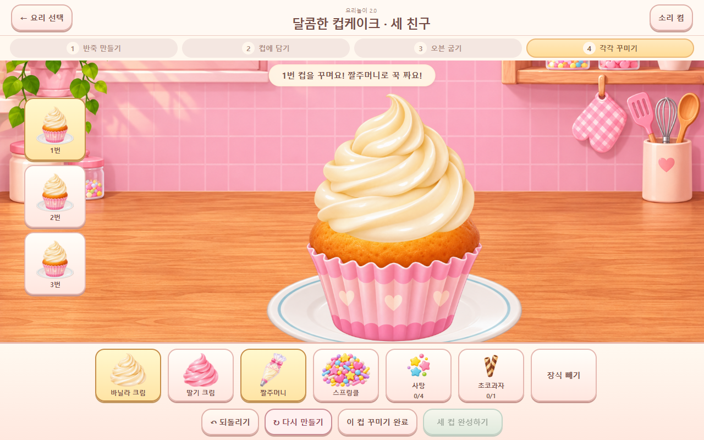
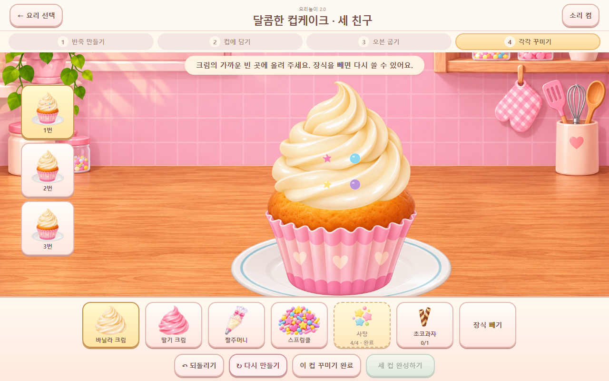
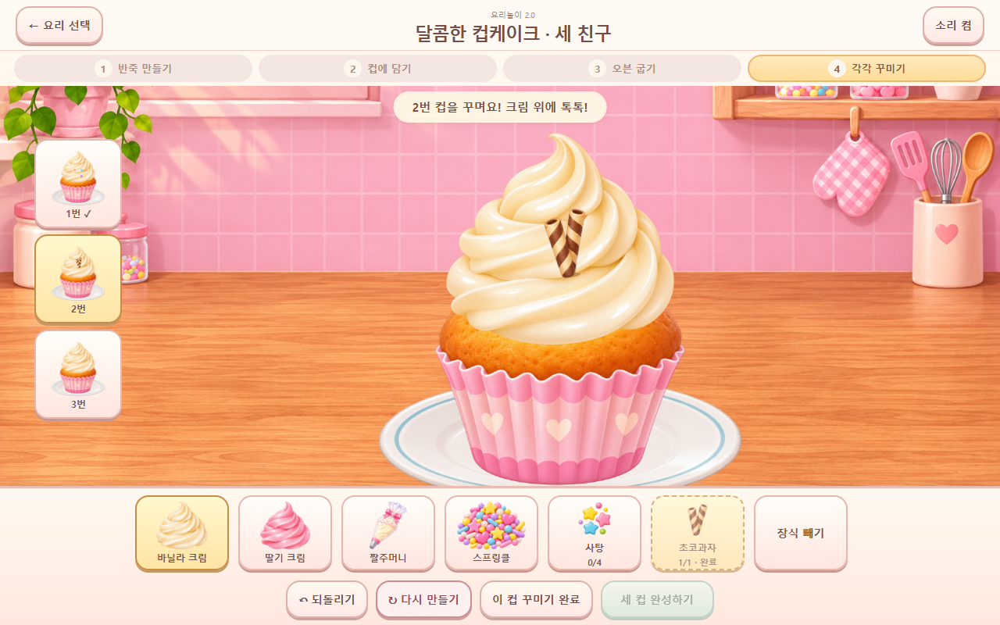
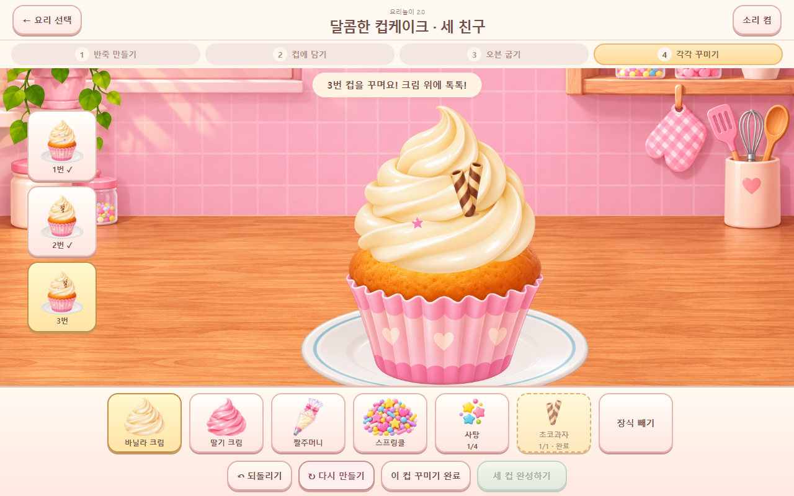
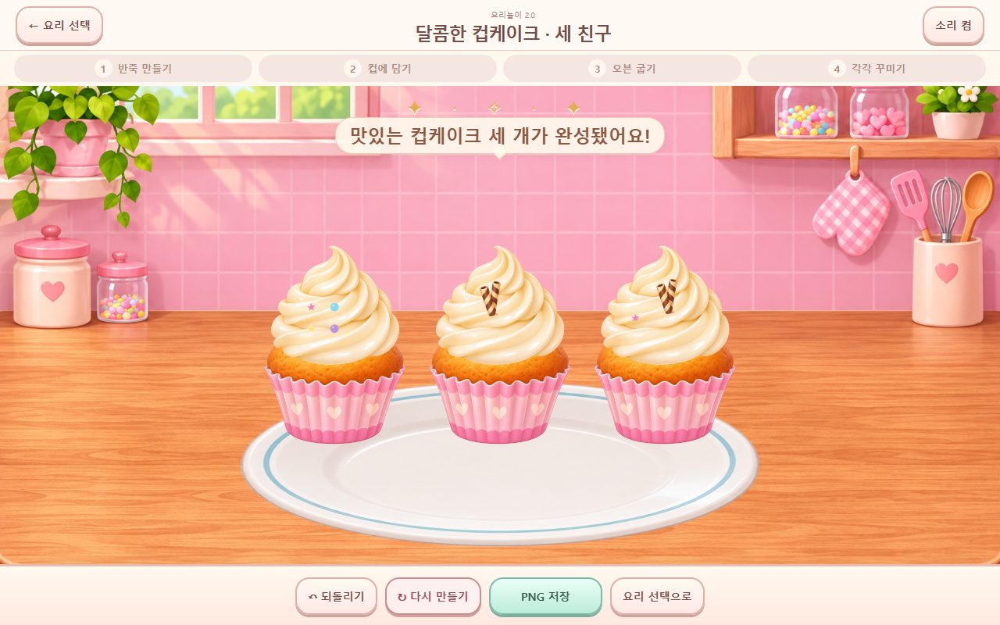
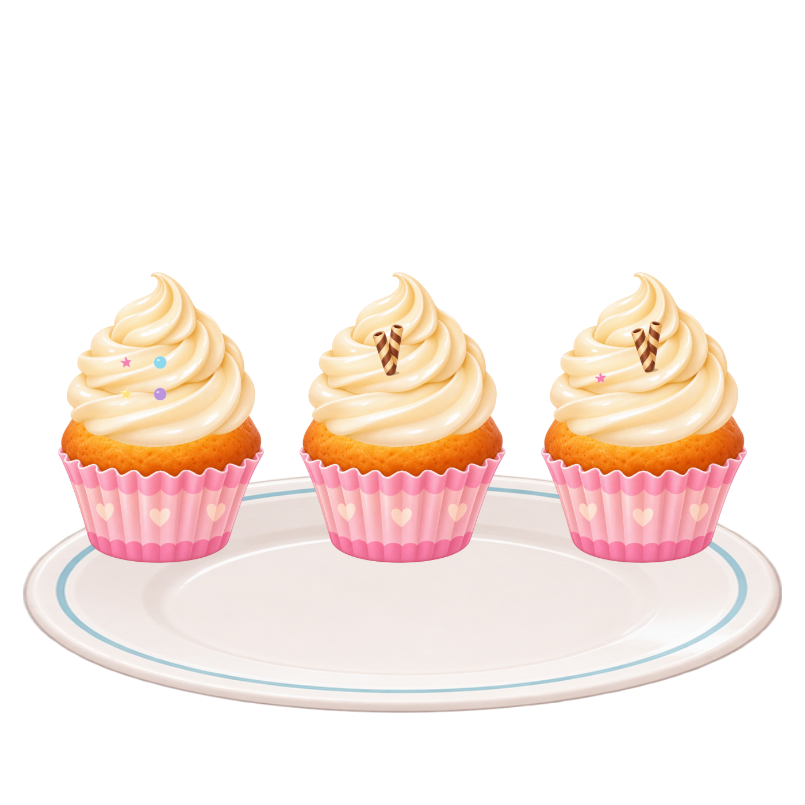

# 세 컵케이크 사탕·초코과자 확장 검수

기준 main: `267a06dc3fe1401c28318f8ff32239f774c967af` (PR #2 병합). 작업일: 2026-11-20.
브랜치: `feat/cupcake-extra-toppings`, PR base: `main`. 병합·배포는 하지 않았다.

## 구현과 보존 범위

기존 스프링클의 추가·드래그·제거 방식과 무제한 사용을 유지했다. 신규 사탕은 아이스크림과 같은 파스텔 5색, 별·구슬 및 하이라이트를 SVG/Canvas로 표현한다. 초코과자는 승인된 두 롤 묶음 PNG를 비율 그대로 재사용한다. 새로운 원화·복제 PNG는 추가하지 않았다.

| 장식 | 컵별 제한 | 배치 |
|---|---:|---|
| 스프링클 | 기존과 같음 | 기존 판정·표현 유지 |
| 사탕 | 4개 | 터치한 크림 위치, 가장자리 여유 검사와 크림 알파 마스크 |
| 초코과자 | 1묶음 | 아래 기준점과 주변이 크림 안에 들어가고 위쪽은 돌출 |

새 장식은 버튼 선택 후 크림 터치 및 카드에서 크림으로 드래그할 수 있다. 가로 목록 스크롤과 드래그를 구분하며 중복 추가하지 않는다. 겹칠 때만 크림 폭 6% 이내에서 가까운 빈자리를 찾고, 없으면 취소·안내한다. 크림이 없는 곳과 컵·배경에는 추가하지 않는다. 작은 크림에서도 사탕/과자 크기가 지나치게 작아지지 않도록 최소 합성 크기를 둔다. 화면에 맞춘 음식 전체의 균일 축소는 유지한다.

선택·횟수·사용 완료 표시를 추가했다. 재료 목록만 필요에 따라 가로 스크롤하며 중앙 음식 및 세 컵 선택의 기존 배치를 유지한다. 과자의 돌출 부분도 원본 알파 픽셀로 판정하여 제거할 수 있다. 제거하면 그 컵의 사용량이 복원되고, 되돌리기는 해당 컵의 크림·스프링클·새 장식을 함께 복원한다.

공통 버튼·확인창, 홈·아이콘 및 다른 요리 기능은 수정하지 않았다. 컵케이크 2초 굽기·2.75바퀴 섞기 설정도 유지한다. `cupcake/model.ts`는 기존 Work에 선택적 토핑 타입만 추가했으며 한 컵 로직은 변경하지 않았다. 새 로직·화면·합성은 `cupcake/three/` 안에 있다.

## 저장 호환

키 `kids-game-playground:v1:game:cooking-v2:cupcake:three:r2`, 버전 2를 유지한다. 각 컵의 `decor.work.toppings`와 기존 `decor.history` 안에 장식 종류·정규화 위치·크기·회전·색상을 저장한다. 스프링클의 숫자 ID와 새 장식의 `extra-N` ID를 구분한다.

이전 기록에 새 필드가 없으면 빈 배열로 보충한다. 잘못된 종류·좌표·크기·회전·색상·중복 ID·초과 개수는 해당 신규 장식만 제외한다. 현재 작업과 전체/컵별 이력을 모두 정규화한 뒤 검증한다. 기존 크림, 짤주머니 진행률, 스프링클, 완료 여부는 유지한다. 새 게임도 처음부터 빈 배열을 두어 재실행 전후 구조가 일치한다.

기존 한 컵 기록 가져오기·보관과 원본 문자열 보존을 검사했다. 다른 요리의 실제 저장 키에는 테스트 전용 표식을 넣어 초기화·취소 뒤에도 보존됨을 검사했다. 실제 사용자의 브라우저 기록에는 접근하지 않았다.

## 화면과 PNG

SVG 미리보기와 Canvas는 같은 장식 기록, 위치·크기 계산 및 별 좌표를 사용한다. 세 컵 완성 화면과 실제 PNG 다운로드는 같은 `renderGroup`을 사용한다. 출력은 기존 1400×1400 투명 PNG이며 접시·세 컵 구성을 유지한다.

- [실제 다운로드 PNG 픽셀 검사](PNG-CHECK.json): 완성 캔버스와 채널 차이 0, 외곽 불투명 픽셀 0, 모서리 알파 0.
- [SVG와 Canvas 추가 비교](SVG-CANVAS-CHECK.json): 바닐라·딸기 × 짤주머니 진행률 0.1/0.55/1의 6조합. 실제 DOM 오버레이를 래스터화하여 출력용 장식 합성 함수와 비교한다. 두 렌더러의 경계 보간 차이를 허용하며 평균 채널 오차 8/255 미만·면적 차이 5% 이내를 기준으로 한다. 이는 SVG와 Canvas의 픽셀이 완전히 같다는 뜻은 아니다.

## 실제 브라우저 캡처

| 토핑 버튼·1280×800 | 1번: 사탕 |
|---|---|
|  |  |
| 2번: 초코과자 | 3번: 사탕+초코과자 |
|  |  |
| 세 컵 완성 | 실제 투명 PNG |
|  |  |

[스마트폰 세로 390×844](screenshots/phone-portrait.png) · [스마트폰 가로 844×390](screenshots/phone-landscape.png)

## 검사와 남은 확인

컵케이크 검사 **22개 통과**. [실행 결과](CHECKS.json), 타입 검사·운영 빌드·Pages 경로·자기 앱 캐시 155개 검사 통과. 컵케이크 전용 설정은 기존 제작·이전 기록·굽기·반응형·오프라인 검사와 신규 장식 검사를 포함한다. 다른 요리 전체 회귀 검사는 실행하지 않는다. CI도 이 작업 브랜치에서는 컵케이크 검사만 실행한다. Pages 배포 workflow는 변경하지 않는다.

예전 검수 원본 문서가 독립 앱에 없던 PNG 감사 검사는 현재 포함된 `docs/migration/FILES.json`의 88개 원본 해시를 사용하도록 고쳤다. 오프라인 검사를 실제로 실행하도록 전용 설정에서 서비스 워커를 허용했다. 재료 카드 드래그 검사는 가로 스크롤과 혼동되지 않게 먼저 위로 들어 올린 뒤 이동한다.

실제 삼성 갤럭시탭·스마트폰에서는 검사하지 않았다. 브라우저 화면 크기 모의 검사이며, 기기 글자 확대와 실제 손가락 조작 확인이 남아 있다. 작은 화면의 재료 목록은 가로 스크롤이 필요하고, 음식 전체 축소에 따라 사탕도 작게 보인다. 크림 외곽 판정은 두 크림의 공통 불투명 영역을 사용하므로 가장자리 일부에서는 추가를 거절할 수 있다. 좁은 곳에 겹쳐 놓으려 할 때 멀리 이동시키지 않고 취소하는 동작은 의도된 제한이다.
