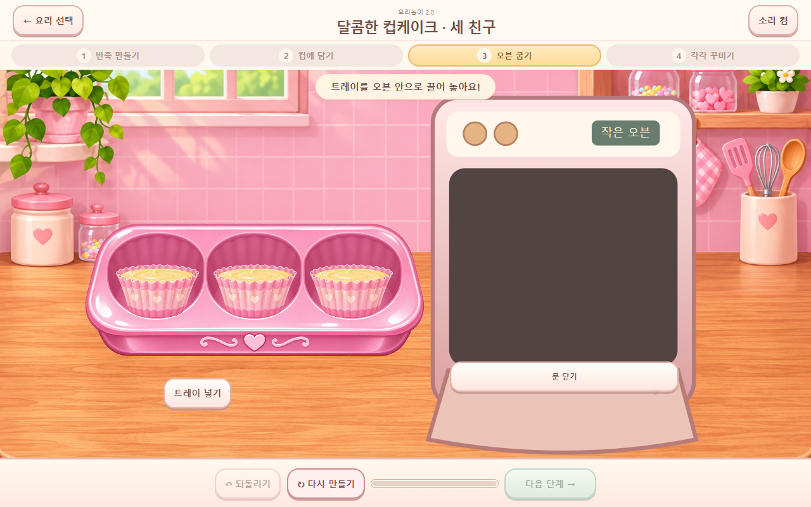
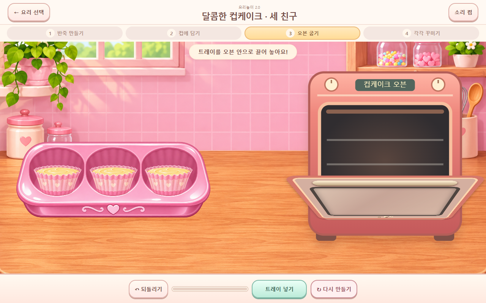
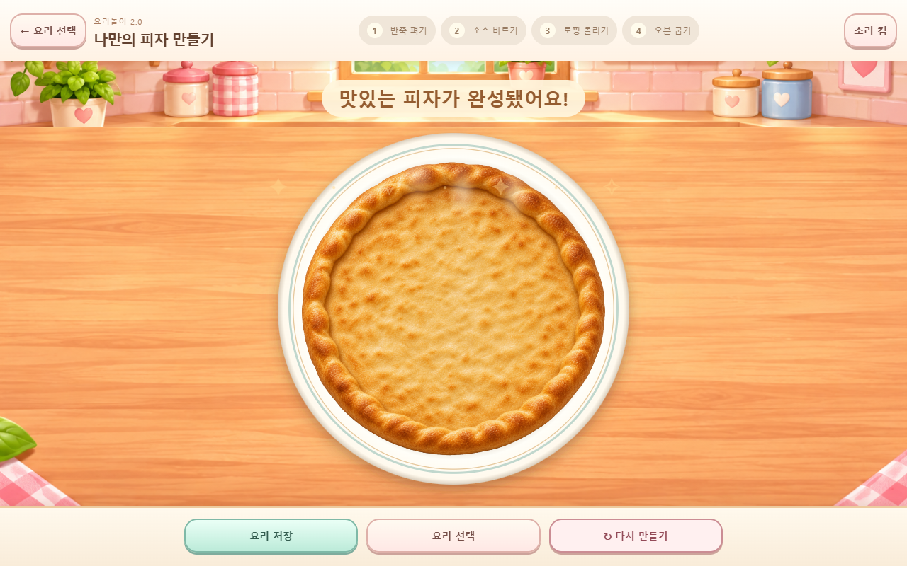
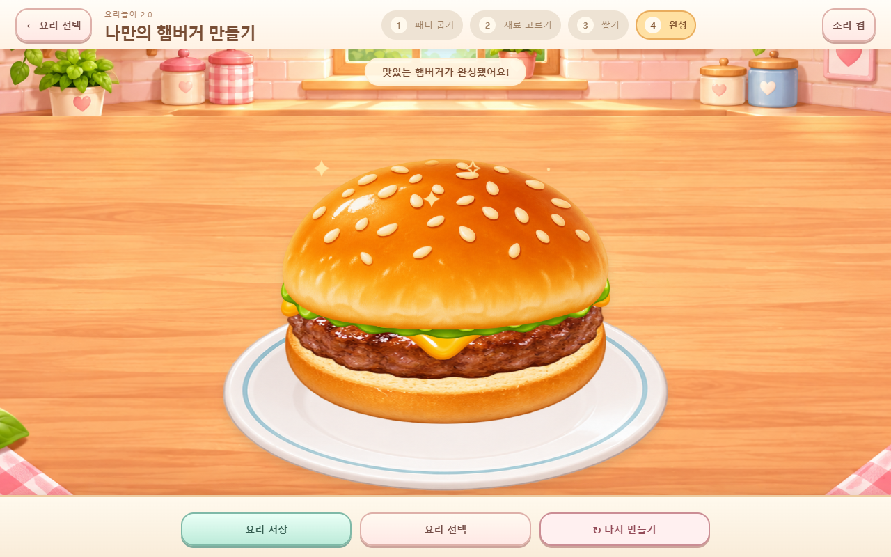
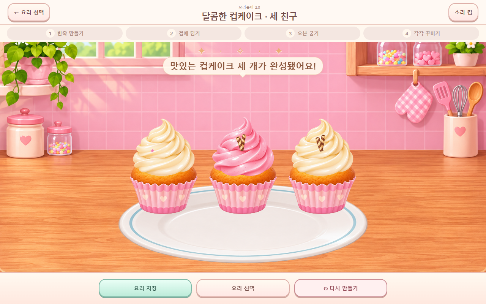
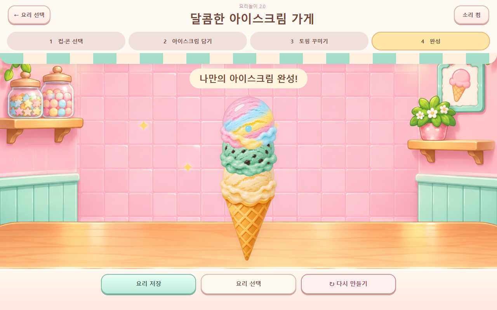
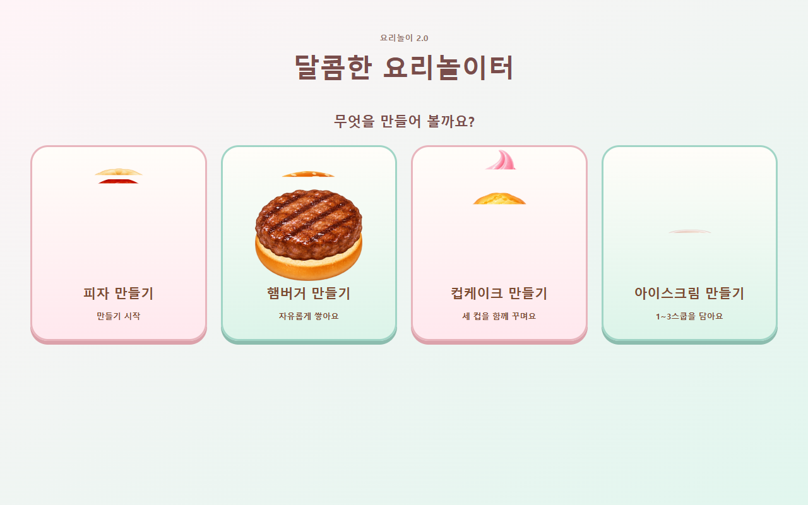
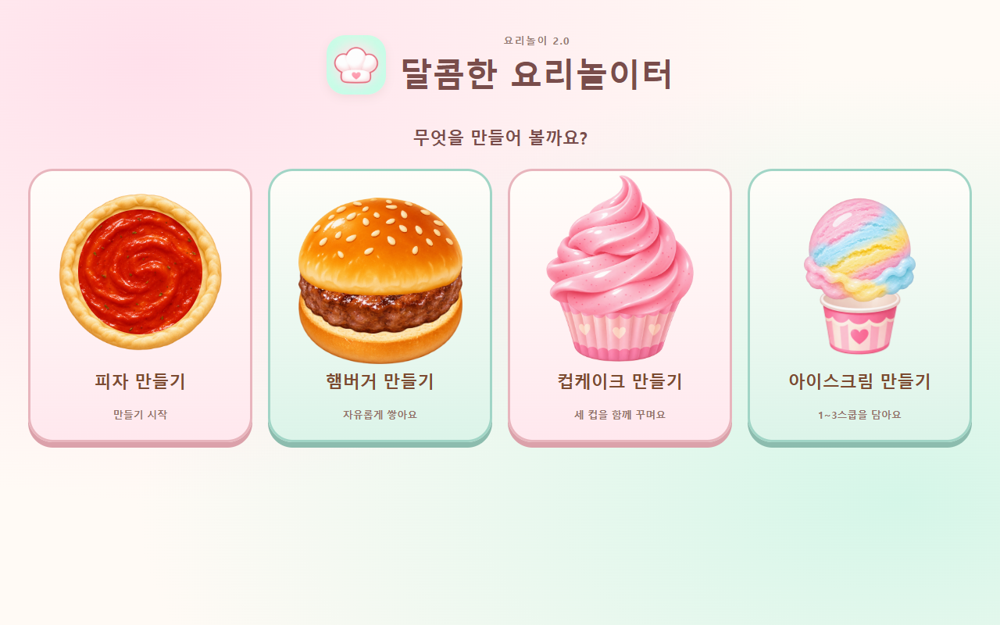
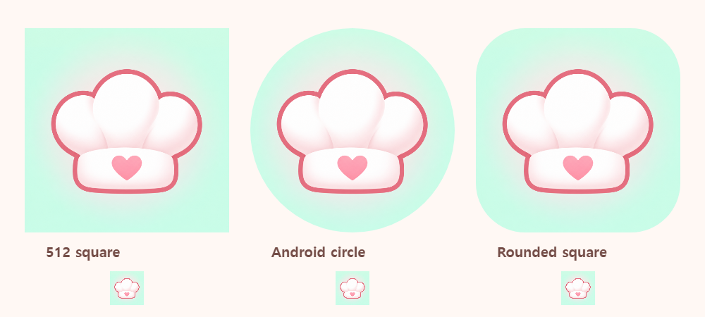

# 달콤한 요리놀이터 최종 통합 검수

작업일: 2026-11-22. 저장소: `leedb333/kids-cooking-studio`.
브랜치: `feat/cooking-studio-final-polish`, Base: `main`, Draft 검토용. 병합·배포는 하지 않는다.

## 시작 기준과 변경 범위

- PR #2와 #3 모두 병합됨을 GitHub에서 확인했다.
- 최신 main: `634749f29a7f8805a1cd99ca237be2fbb2c4c4e7`.
- 마지막 성공한 Pages 배포도 같은 커밋이다. [배포 기록](https://github.com/leedb333/kids-cooking-studio/actions/runs/44695719419), 실행일 2026-11-20.
- 새 작업 브랜치는 위 main에서 시작했다. 원본 종합 놀이터와 색칠놀이 저장소는 수정하지 않았다.
- 기존 음식 PNG 88개, 저장 모델 및 음식 합성 코드 20개는 [108개 파일 해시 기준](UNCHANGED-FILES.json)으로 보호한다. 새 아이콘은 별도 파일이다.

| 구분 | 변경 내용 |
|---|---|
| 외형·배치 | 컵케이크 오븐 외형, 공통 완성 버튼, 홈 카드, 전용 아이콘 |
| 조작 | 컵케이크 하단 진행 버튼·드래그, 아이스크림 상단 이전 단계 이동, 불필요 버튼 제거 |
| 안전 보완 | 오븐 중복 입력 방지, 실제 음식 변경 때 더 이상 스쿱 위에 놓이지 않는 장식만 제외 |
| 유지 | 음식 규칙·원화·합성 좌표·굽기 시간·저장 키/버전·PNG 출력 정책·소리 설정 처리 |

## A. 오븐과 아이스크림 이동

### 피자·컵케이크 오븐

`shared/OvenShell.tsx`는 기존 피자의 SVG 몸체·손잡이·유리문·문 열림 표현을 그대로 공통화한 표시 컴포넌트다. 피자는 기존 상태와 이벤트 콜백을 계속 사용한다. 컵케이크는 별도의 `CupOven`과 기존 세 컵 모델을 사용한다. 두 게임의 모델을 합치지 않았다.

세 컵 트레이는 승인된 기존 트레이와 `renderTray`로 표시한다. 이동할 때 같은 트레이를 유지하며 CSS 위치·표시 크기만 부드럽게 바꾼다. 컵의 ID, 원화, 3개 고정 배치와 케이크 성장 계산은 변경하지 않았다. 피자 그림을 컵케이크 오븐에 사용하지 않는다.

별도 장면 안의 ‘트레이 넣기’ 버튼은 제거했다. 트레이를 드래그하거나 하단 진행 버튼으로 동일한 동작을 실행한다. 문 자체도 터치할 수 있다.

| 컵케이크 상태 | 하단 진행 버튼 |
|---|---|
| 준비 | 문 열기 |
| 문 열림 | 트레이 넣기 |
| 트레이 들어감 | 문 닫고 굽기 |
| 굽는 중 | 굽는 중… — 비활성 |
| 굽기 완료 | 문 열기 |
| 완료 후 열림 | 다음 단계 → |

오븐 전환 동안 잠깐 입력을 막아 두 번 터치로 두 상태를 건너뛰지 않도록 한다. 굽기는 기존 활성 시간 기준 2초다. 이전 기록의 ready/open/inside/baking/done/revealed 및 3000ms 경과 기록을 기존 모델로 읽고 새 시간 상한에 맞춘다. 반죽·채우기·꾸미기·PNG 코드는 그대로다.

실제 Chrome 터치 이벤트 검사에서 트레이 드래그 직후 다음 터치의 `pointerup`은 오지만 `click`이 오지 않는 경우를 발견했다. 컵케이크의 하단 진행 버튼과 오븐 문은 유효한 터치 종료도 처리하고, 뒤따르는 클릭은 중복 처리하지 않도록 보완했다. 피자에는 이 추가 입력 방식을 적용하지 않는다.

| 이전 컵케이크 오븐 | 공통 외형 적용 후 |
|---|---|
|  |  |

[피자 오븐](screenshots/pizza-oven.png) · [트레이 들어간 뒤](screenshots/cupcake-tray-after.png)

### 아이스크림 단계 이동

| 단계 | 하단 조작 |
|---|---|
| 컵·콘 선택 | 다음 단계 → / ↻ 다시 만들기 |
| 아이스크림 담기 | ↶ 되돌리기 / 토핑 꾸미기 → / ↻ 다시 만들기 |
| 토핑 꾸미기 | ↶ 되돌리기 / 완성 보기 → / ↻ 다시 만들기 |
| 완성 | 요리 저장 / 요리 선택 / ↻ 다시 만들기 |

이전 단계는 상단의 큰 진행 버튼으로 이동한다. 현재 단계와 미래 단계는 이동 버튼으로 작동하지 않는다. 완성 단계의 진행 표시는 읽기 전용이다. 단계 이동만으로 스쿱·용기·장식 데이터가 삭제되거나 다시 뿌려지지 않는다.

실제로 용기나 스쿱을 바꾸는 경우에는 기존 장식의 저장 위치·회전·시럽 경로·스프링클 점들을 다시 생성하지 않는다. 바뀐 음식의 실제 보이는 영역과 스쿱 번호를 확인해 더 이상 해당 음식 위에 놓이지 않는 장식만 제외한다. 예를 들어 3번째 스쿱을 빼면 그 스쿱의 장식은 빠지고, 남은 스쿱 위의 유효한 장식 기록은 그대로 유지한다. 제외되는 장식이 있으면 짧게 안내한다. 토핑 종류별 사용량은 남은 장식에서 계산하므로 제거한 만큼 돌려받는다.

기존 오른쪽 2열×3행 패널과 동일한 800×1160 음식 좌표를 유지한다. 좁은 가로 화면에서는 패널 여백과 안내 배치를 줄여 카드와 음식을 표시할 공간을 확보한다.

[1단계](screenshots/icecream-step-1.png) · [2단계](screenshots/icecream-step-2.png) · [3단계](screenshots/icecream-step-3.png)

## B. 완성 화면과 제작 버튼

네 요리는 작은 공통 `FinishActions`를 사용한다. 기존 다운로드 함수와 초기화 콜백을 연결한다.

| 요리 | 완성 화면 하단 버튼 — 동일 순서 |
|---|---|
| 피자 | 요리 저장 / 요리 선택 / ↻ 다시 만들기 |
| 햄버거 | 요리 저장 / 요리 선택 / ↻ 다시 만들기 |
| 세 컵케이크 | 요리 저장 / 요리 선택 / ↻ 다시 만들기 |
| 아이스크림 | 요리 저장 / 요리 선택 / ↻ 다시 만들기 |

저장은 민트, 선택은 크림, 초기화는 연분홍이다. 같은 높이·글씨·간격을 사용한다. 제작 과정의 다시 만들기는 맨 마지막에 배치한다. 피자 소스·토핑 단계의 떠 있는 중복 초기화 버튼도 하단으로 옮겼다. 되돌리기는 제작 중에만 표시하고 기존 기록 처리 방식을 유지한다.

컵케이크 완료의 되돌리기, 햄버거 완료의 다시 쌓기, 아이스크림 완료의 가게로/꾸미기 수정은 제거했다. 작품을 바꾸려면 다시 만들기를 확인해야 한다. 요리 선택으로 나갔다가 다시 열면 완료 작품을 감상할 수 있으며 이동만으로 초기화하지 않는다. 공통 ResetDialog의 취소는 상태를 바꾸지 않고, 확인은 해당 요리만 초기화한다.

| 피자 | 햄버거 |
|---|---|
|  |  |
| 세 컵케이크 | 아이스크림 |
|  |  |

[피자 확인창](screenshots/pizza-reset.png) · [햄버거 확인창](screenshots/burger-reset.png) · [컵케이크 확인창](screenshots/cupcake-reset.png) · [아이스크림 확인창](screenshots/icecream-reset.png)

### 저장 기록과 PNG

| 요리 | 유지한 저장 키 | 버전 |
|---|---|---:|
| 피자 | `kids-game-playground:v1:game:cooking-v2:pizza:full:r1` | 1 |
| 햄버거 | `kids-game-playground:v1:game:cooking-v2:burger:prototype:r1` | 1 |
| 세 컵케이크 | `kids-game-playground:v1:game:cooking-v2:cupcake:three:r2` | 2 |
| 아이스크림 | `kids-cooking-v2-icecream-v1` | 1 |

키·버전 및 각 게임의 읽기/쓰기 모델은 바꾸지 않았다. 컵케이크의 한 컵 기록 가져오기·보관도 유지한다. 테스트 브라우저의 가상 기록으로 호환과 다른 요리 기록 보존을 확인하며 실제 사용자의 저장 기록에는 접근하지 않는다. `localStorage.clear()`는 사용하지 않는다.

출력은 모두 1400×1400이다. 피자의 기존 불투명 배경과 다른 세 요리의 기존 투명 배경 정책을 유지한다. 컵케이크·아이스크림의 실제 완성 화면과 PNG를 비교할 때 반투명 픽셀의 단순 RGB 반올림 대신 알파가 적용된 표시 색을 기준으로 검사한다. 결과는 [PNG-CHECK.json](PNG-CHECK.json)에 기록한다. 원래 합성 함수 자체는 해시로 보호한다.

[실제 컵케이크 PNG](cupcake-download.png) · [실제 아이스크림 PNG](icecream-download.png)

## C. 홈과 전용 아이콘

태블릿 가로에서는 4개 카드를 한 줄로 선택했다. 1280×800, 1280×720, 1024×600에서 네 카드가 같은 크기로 화면 안에 들어가며 음식 이미지를 크게 표시한다. 스마트폰 가로에서는 2열, 좁은 세로에서는 1열이다. 메뉴가 늘면 다음 줄과 세로 스크롤을 사용하고 카드 크기를 메뉴 수에 맞춰 줄이지 않는다.

| 이전 | 이후 |
|---|---|
|  |  |

새 전용 아이콘은 분홍 테두리 요리사 모자·작은 하트·민트 배경이다. 이미지 생성 도구로 만들고 192/512 크기로 균일 축소했다. 기존 음식 원본은 편집하지 않았다. [아이콘 제작 정보](ICON.md), [실제 크기·알파 검사](PWA-CHECK.json), [마스커블 안전 영역](ICON-CHECK.json).

- `public/icons/cooking-studio-192.png`
- `public/icons/cooking-studio-512.png`
- `public/icons/cooking-studio-maskable-512.png`

모든 진입 HTML의 favicon/홈 아이콘과 manifest를 연결했다. 앱 ID·start_url·scope는 `/kids-cooking-studio/` 그대로다. 서비스 워커 등록 범위와 자기 앱 캐시만 정리하는 기존 규칙도 유지했다. 새 아이콘은 자동 생성 오프라인 목록에 들어간다. Pages 배포 workflow는 수정하지 않았다.

## D. 통합 검사와 남은 확인

실행 내역은 [CHECKS.json](CHECKS.json)에 정리한다. 변경 기능과 네 요리의 핵심 제작을 선택한 전용 설정 `tests/final-polish.config.ts`를 사용한다. 전체 과거 게임 테스트를 실행하지 않는다. 기준 화면은 1280×800, 1280×720, 1024×600, 844×390, 390×844다.

- 첫 통합 실행: 46개 중 45개 통과, 컵케이크 드래그 직후 터치 1개 실패. 위 입력 보완 후 새 네이티브 터치 회귀 검사도 추가했다.
- 수정 후 관련 재검사: **25개 통과**, 실패·건너뜀·불안정 재시도 0개. 네 요리 제작, 기존 오븐 기록, 버튼·홈·저장·화면·PNG·실제 시럽 터치가 포함된다.
- 이전 통과 결과와 마지막 재검사를 합친 서로 다른 선택 검사 **47종의 최신 결과가 모두 통과**다. 동일한 전체 묶음을 로컬에서 반복 실행하지 않았다. GitHub CI는 최종 커밋에서 선택 47종을 한 번 실행한다.
- `pnpm exec tsc --noEmit`, `pnpm build`, `pnpm verify` 통과. Pages base `/kids-cooking-studio/`, 오프라인 캐시 159개 파일·경로 누락 없음.
- [변경 파일 전체 목록](CHANGED-FILES.txt). 검사 결과에는 첫 실패와 보완 과정도 남겼다. 실제 사용자의 저장 데이터나 기존 설치 캐시는 변경하지 않았다.

기존 검사의 버튼 이름을 새 요구사항에 맞췄다. 완성 화면에서 수정으로 돌아가는 제거된 동작은 없는 것을 검사하고, 여러 PNG 비교에 필요한 꾸미기 입력은 별도의 테스트 기록으로 공급한다. 과거 검수 캡처를 덮어쓰지 않도록 기존 핵심 검사의 실행 자료는 `playwright-report/` 아래에 저장한다.

[스마트폰 가로 완료](screenshots/complete-844x390.png) · [세로 완료](screenshots/complete-390x844.png) · [가로 토핑](screenshots/icecream-topping-844x390.png) · [세로 토핑](screenshots/icecream-topping-390x844.png) · [작은 가로 오븐](screenshots/cupcake-oven-844x390.png) · [세로 오븐](screenshots/cupcake-oven-390x844.png)

### 배포 뒤 사용자가 확인할 사항 — 이번에는 배포하지 않음

1. 갤럭시탭에서 트레이 드래그와 하단 버튼만의 진행을 각각 확인한다.
2. 네 요리의 저장→요리 선택→완료 작품 다시 열기를 확인한다.
3. 스마트폰에서 상단 이전 단계와 토핑 패널을 손가락으로 조작한다.
4. 기존 설치 앱을 모두 닫고 다시 열어 새 화면과 기록 유지 여부를 확인한다. 기존 워커는 새 버전을 기다리게 할 수 있으며, 창이 닫힌 뒤 활성화되는 방식은 [서비스 워커 업데이트 문서](https://developer.mozilla.org/en-US/docs/Web/API/Service_Worker_API/Using_Service_Workers#updating_your_service_worker)와 같다.
5. 기존 설치 앱의 아이콘은 브라우저 버전에 따라 별도 업데이트 확인이 필요할 수 있다. Chrome은 이름·아이콘 변경을 사용자가 확인하는 방식으로 다룬다. [Chrome 공식 업데이트 안내](https://developer.chrome.com/blog/improvements-to-web-app-updates). 새로 설치하는 경우에는 새 모자 아이콘과 앱 이름·시작 화면을 확인한다. 앱 ID를 유지하는 이유는 [동일 앱 식별 문서](https://developer.chrome.com/docs/capabilities/pwa-manifest-id)에 따른다.

실제 삼성 기기의 설치·아이콘 갱신·글자 확대·손가락 조작은 검사하지 않았다. 자동검사와 캡처는 실제 Chrome 브라우저의 화면 크기 모의 검사다. 기존 설치 앱을 지우거나 사이트 데이터를 초기화하는 절차는 이 작업에 포함하지 않았다.

사용자가 검토 후 별도로 승인하면 Draft를 해제하고 병합한 뒤, 기존 **Publish to GitHub Pages (manual)** workflow를 `main`으로 실행할 수 있다. 이 작업에서는 그 조작을 수행하지 않는다.
