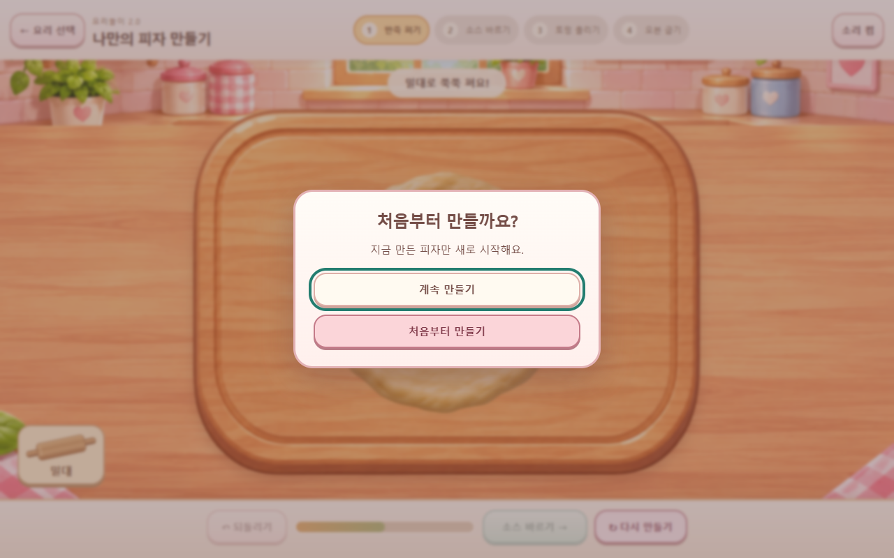
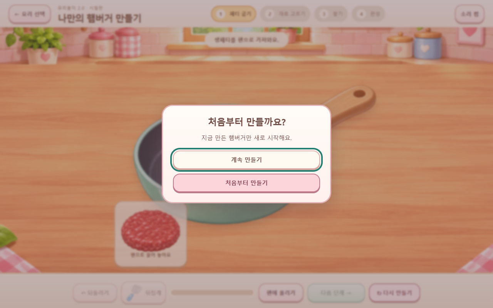
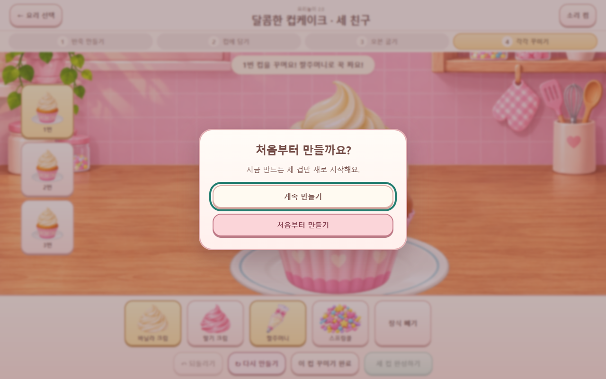
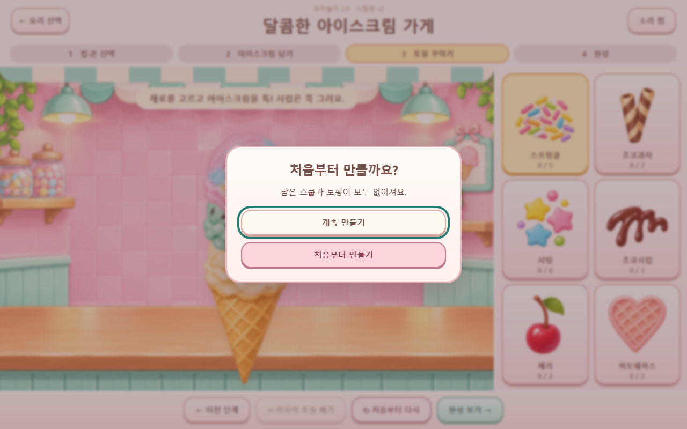
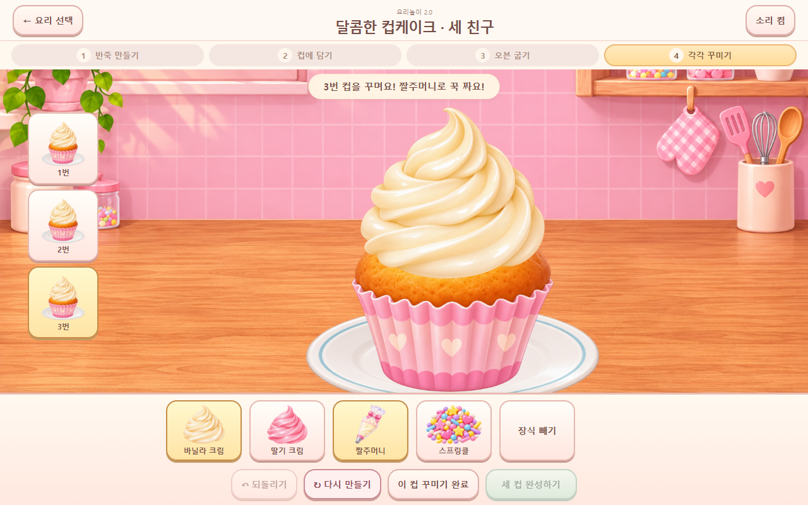
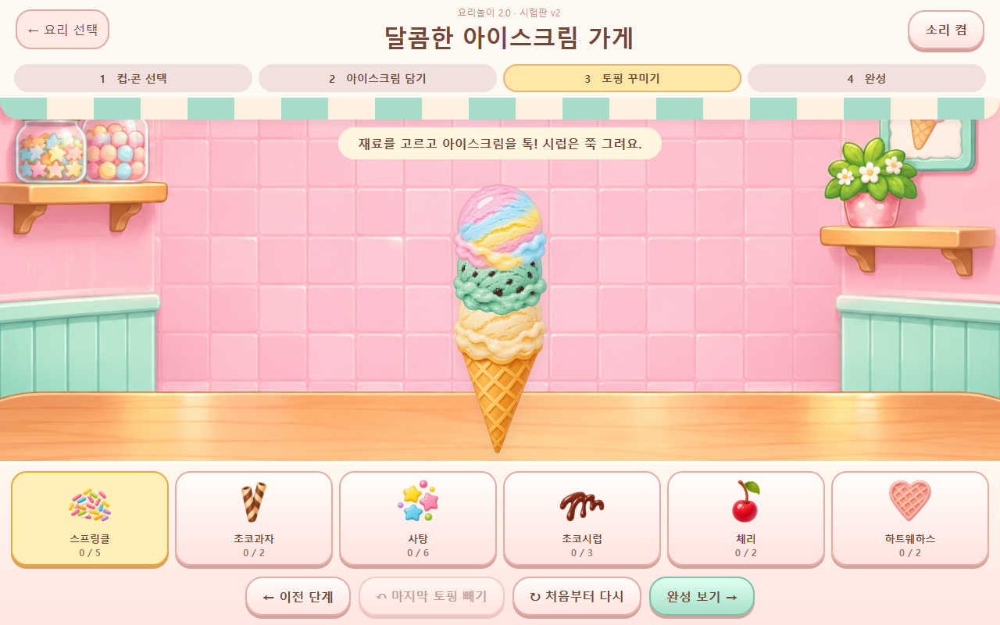
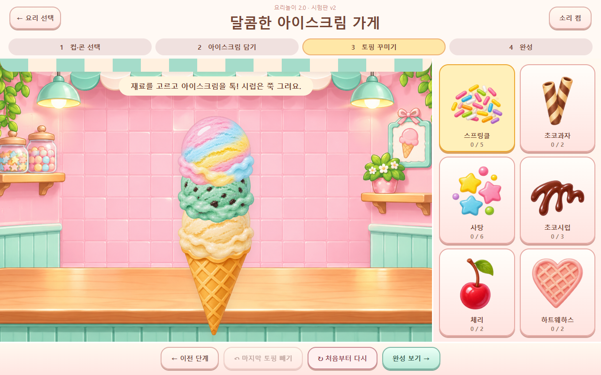
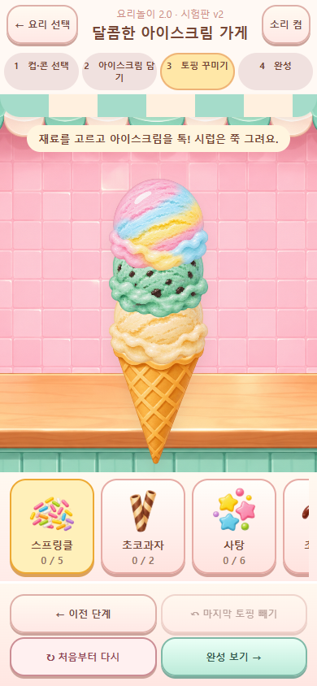
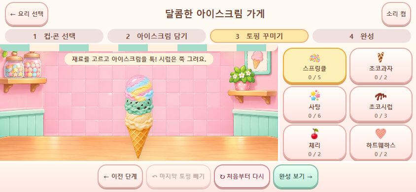

# 공통 디자인·레이아웃·대기시간 개선 검수

확인일: 2026-11-20. 기준 main: `000a893ceb6d95bb716c2d3e5889dfe4850564de`.
브랜치: `feat/cooking-ui-layout-speed-v1`. 원본 종합 놀이터는 수정하지 않았다. 병합·배포는 실행하지 않았다.

## 변경 범위

1. 네 게임의 공통 조작 버튼과 다시 만들기 확인창.
2. 세 컵케이크 선택 영역의 높이·하단 여유.
3. 아이스크림 **3단계만** 왼쪽 음식 / 오른쪽 2열×3행 토핑 카드.
4. 피자·세 컵케이크의 게임에 설정된 굽기 시간과 섞기 요구량.

컵케이크 신규 사탕·초코과자, 장식 데이터 구조, 저장 키, 기존 PNG는 변경하지 않았다. 아이스크림 1·2·4단계의 배치 구조와 음식 합성 좌표도 유지했다. 기존 소스 PNG 88개와 변경하지 않은 합성·토핑 모델은 원본 해시로 확인했다.

## 공통 버튼·확인창

공통 CSS 변수와 버튼 스타일을 추가했다. 일반 조작 버튼은 크림/연분홍, 주요 다음·완성·PNG 버튼은 민트, 초기화는 장밋빛 테두리로 구분한다. 최소 높이 48px, 둥근 모서리, 공통 글자 크기 체계, 비활성·눌림·키보드 포커스를 제공한다. 그림 카드와 요리별 특수 버튼을 전부 재작성하지 않았다.

| 게임/단계 | 이전 다시 만들기 확인창 | 변경 후 |
|---|---|---|
| 피자 | 피자를 처음부터 만들까요? / 기존 개별 native dialog | 공통 확인창 |
| 햄버거 | 햄버거를 처음부터 만들까요? / 기존 개별 native dialog | 공통 확인창 |
| 세 컵케이크 | 처음부터 만들까요? / 개별 버튼 스타일 | 공통 확인창 |
| 아이스크림 1·2단계 | 처음부터 다시 만들까요? / 별도 overlay | 공통 확인창 |
| 아이스크림 토핑 | 계속 꾸미기 / 처음부터 만들기 | 계속 만들기 / 처음부터 만들기 |
| 아이스크림 완성 | 새 아이스크림을 만들까요? / 계속 감상하기 / 새로 만들기 | 공통 제목·버튼으로 통일 |

공통 제목은 **처음부터 만들까요?**, 취소는 **계속 만들기**, 확인은 **처음부터 만들기**다. 요리별 설명은 유지했다. 작은 `ResetDialog`만 공통화하고 기존 초기화 콜백과 소리 설정 보존을 그대로 연결했다.

native `showModal()`로 뒤쪽 화면을 inert 처리한다. 취소 버튼에 먼저 포커스하고, Tab/Shift+Tab을 두 버튼 안에서 순환시키며, ESC·취소 후 원래 버튼으로 포커스를 복귀시킨다. 취소 전후 저장 문자열이 같고, 확인 시 해당 요리만 초기화되는지 검사했다.

| 피자 | 햄버거 |
|---|---|
|  |  |
| 세 컵케이크 | 아이스크림 |
|  |  |

## 세 컵 선택 영역

`.ct-select`를 장면의 위·아래 경계 안에 제한하고 하단 여유를 확보했다. 버튼은 동일한 크기·간격으로 유지하면서 실제 장면 높이에 맞춰 줄어든다. 아주 작은 장면에는 선택 영역 안의 스크롤을 허용한다. 작은 가로 화면의 기존 가로 선택 방식은 유지했다. 중앙 컵케이크의 합성·크기 계산은 변경하지 않았다.

1280×800, 1280×720, 1024×600, 844×390, 390×844에서 세 버튼의 장면 내부 위치와 48px 이상 터치 크기를 확인했다. 3→1→2→3번 전환과 저장된 선택 번호도 검증했다.

기본 1280×800의 수정 전 자동 캡처에서는 세 버튼이 보였다. 실기에서의 잘림 조건을 동일하게 재현했다고 주장하지 않는다. 이번 변경은 선택 목록의 하단 제한이 없던 구조를 보완하고 낮은 높이에서도 검증한 것이다. 기기의 글자 확대·브라우저 바 상태는 실기 확인이 남아 있다.

## 아이스크림 토핑 패널과 실제 음식 크기

3단계에만 별도의 grid를 적용했다. 제목·진행 단계는 위, 음식은 왼쪽, 패널은 오른쪽, 조작은 아래다. 카드 순서는 다음과 같다.

| 왼쪽 카드 | 오른쪽 카드 |
|---|---|
| 스프링클 | 초코과자 |
| 사탕 | 초코시럽 |
| 체리 | 하트웨하스 |

기존 승인 PNG·이름·사용량/제한을 그대로 표시한다. 선택은 강조하고 제한에 도달하면 흐리게·점선으로 표시하며 기존 추가 제한을 유지한다. 가용 너비 740px 이상·높이 350px 이상에서는 2열 패널, 스마트폰 세로에서는 아래쪽 가로 스크롤 목록을 사용한다. 높이가 부족하면 오른쪽 패널만 내부 스크롤한다.

동일한 Chrome, 1280×800, 기본 100% 배율/1배 픽셀 해상도에서 **동일한 콘·바닐라/민트초코/레인보우 3스쿱·토핑 없는 상태**로 비교했다. 원본 main의 로컬 운영 빌드를 수정 전으로 캡처했다. 캔버스의 알파 경계를 실제 표시 배율에 곱해 음식 자체의 높이를 측정했다.

| 측정 | 이전 | 이후 | 변화 |
|---|---:|---:|---:|
| 캔버스 표시 높이 | 386px | 525px | +139px |
| 실제 음식 높이 | 344.07px | 467.97px | **+123.90px, +36.01%** |

| 이전 — 같은 1280×800 | 이후 — 같은 1280×800 |
|---|---|
|  |  |

[오른쪽 패널 확대 캡처](screenshots/topping-panel.png) · [실측 자료](COMPARISON.json)

800×1160 논리 캔버스, 스쿱·토핑 합성, 정규화 저장 좌표는 변경하지 않았다. 표시 박스의 실제 크기와 여백으로 터치 좌표를 역산하는 기존 계산을 유지했다. 오른쪽에서 왼쪽으로 끄는 동작이 기존 가로 목록 스크롤로 분류되지 않도록 **실제 grid 여부**로 구분했다. 아래쪽 목록의 가로 스크롤·취소 동작은 보존했다.

컵·콘 각 1~3스쿱, 6종 제한·되돌리기·영역 판정·분산·겹침 보정, 실제 오른쪽 카드 터치 드래그, 시럽 3점 경로와 저장 후 같은 장식 복원을 검증했다. 컵·콘 × 1~3스쿱 × 토핑 유무 12조합의 화면·PNG 합성 일치와 투명 배경, 잘림 없음도 확인했다.

## 대기시간과 예전 기록

| 항목 | 이전 | 변경 | 단축 |
|---|---:|---:|---:|
| 피자 굽기 | 4초 | 2.5초 | 37.5% |
| 세 컵케이크 굽기 | 3초 | 2초 | 약 33.3% |
| 세 컵케이크 섞기 | 4바퀴 | 2.75바퀴 | 약 31.3% |

이 값은 **게임의 활성 시간·누적 입력 요구량**이다. 실제 기기의 느린 프레임·이미지 최초 로딩·터치 누락 시간을 측정하거나 줄였다는 뜻은 아니다. 애니메이션과 진행 표시의 분모도 새 굽기 시간으로 조정했다. 한 컵 기록을 보는 호환 화면의 모델은 유지했다.

피자는 예전 최대 4000ms, 세 컵케이크는 3000ms까지의 유효 기록을 계속 받아들인다. 새 기준보다 긴 경과시간은 새 최대값으로 제한하되 음식·장식·선택·완성 단계는 초기화하지 않는다. 컵케이크의 되돌리기 이력도 같은 방식으로 시간만 정규화한다. 굽기 단계의 완료 후 문 열기/다음 단계 동작은 유지한다.

저장 키·버전·장식 데이터 형식은 변경하지 않았다. 한 컵 기록 가져오기·원본 기록 보관·취소도 재검사했다. 움직임 없는 거품기 입력은 되돌리기 이력을 추가하지 않는다.

## 실행한 검사

- 전용 config: `pnpm exec playwright test --config tests/ui-layout-speed.config.ts`.
- 관련 24개 검사 통과. 마지막 보호 조건·원본 보존 2개 재검사 통과. 실제 거품기 터치·다른 기록 보존 관련 4개 추가 검사도 통과. 중복 제외 최종 항목 26개. 전체 게임 수백 개 검사나 다른 게임 저장소 검사는 실행하지 않았다.
- 시간 조건은 모델 단위의 가상 누적 시간으로 검사하여 2초/2.5초를 불필요하게 기다리지 않는다. 실제 브라우저 굽기 정지·재개 핵심 검사만 추가했다.
- 모달 4게임 × 3화면 크기, 컵 선택 5화면 크기, 아이스크림 2용기 × 1~3스쿱 × 3화면 크기를 확인했다.
- TypeScript·운영 빌드 통과. Pages base와 155개 캐시 URL의 실제 파일 존재를 확인했다. 새 공통 CSS/JS는 기존 빌드 캐시 생성기에 자동 포함된다.
- 홈 왕복과 네 게임 오프라인 재진입, 다른 캐시 표식 보존 확인. 기존 앱 캐시나 사용자 데이터를 삭제하지 않았다.
- GitHub에서는 이 브랜치에 관련 26개만 실행하고 기존 기본 요리 검사 경로는 보존한다.

[로컬 검사 기록](CHECKS.json) · [PNG 비교](PNG-CHECKS.json) · [변경 파일 전체](CHANGED-FILES.txt)

## 스마트폰과 남은 확인

| 세로 390×844 | 가로 844×390 |
|---|---|
|  |  |

[스마트폰 확인창](screenshots/phone-modal.png) · [실제 드래그·시럽 후](screenshots/touch-syrup.png)

실제 삼성 갤럭시탭·스마트폰 검사는 하지 않았다. 실기에서 브라우저 바·글자 확대·손가락 조작을 최종 확인해야 한다. 작은 가로 화면에서는 카드 이미지가 태블릿보다 작고, 더 낮은 높이에서는 패널 스크롤이 필요할 수 있다. 기존 PNG 원본을 바꾸거나 음식 합성을 변형하여 크기를 늘리지 않았다.

이번 단계에서는 Draft PR만 제출한다. main 병합·Pages 배포·새 컵케이크 토핑 추가·다른 저장소 변경은 수행하지 않는다.
